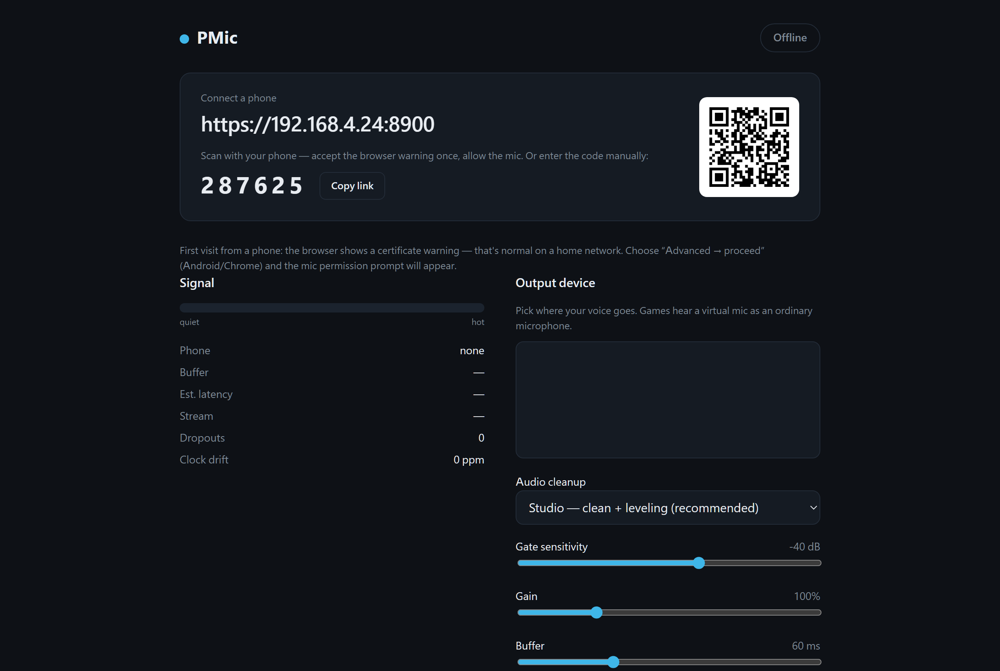
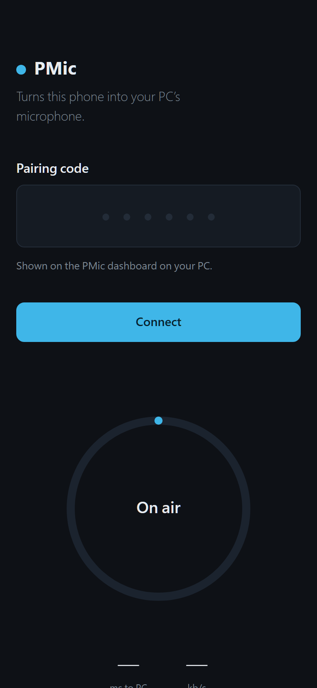

<p align="center">
  
</p>

<h1 align="center">PMic</h1>

<p align="center">
  <b>Your phone is the microphone your PC is missing.</b><br>
  Open a link, enter a code, and any game, call or recording app hears you.
</p>

<p align="center">
  <a href="LICENSE"></a>
  
  
  <a href="https://github.com/MrNova420/pmic/releases"></a>
  
</p>

---

> **This is a beta (v1.4.1-beta.1).** The audio path, pairing, driver install and
> packaging are real and tested, but it's software with one author — and it
> installs an *audio driver*, which is the part most likely to surprise you. Read
> [Known limitations](#known-limitations) before installing. Bug reports are
> genuinely wanted.

## Why

You already own a decent microphone: it's in your pocket. PMic turns it into a
real Windows recording device over your own Wi-Fi, with no app to install on the
phone and nothing leaving your network.

- **No phone app.** A web page served by your PC. Open it, enter the 6-digit code
  from the dashboard, allow the mic. That's the whole setup.
- **Appears as a real microphone.** With the bundled virtual-audio driver, games,
  Discord and OBS see it as an ordinary mic input.
- **LAN only.** No accounts, no cloud, no telemetry, no ads. Audio goes phone → PC
  over HTTPS/WebSocket on your own network and stops there.
- **Low latency.** ~40 ms capture frames, an adaptive 20–150 ms jitter buffer and
  a WASAPI output path. Target is under 150 ms mouth-to-app on decent Wi-Fi.
- **Self-contained.** No Python, no runtime downloads, no CDN — the EXE and the
  virtual-mic driver are both inside the installer.

## How it works

```
Phone (any browser)                      PC
┌───────────────────────────┐    WSS    ┌──────────────────────────────┐
│ getUserMedia (mono 48 kHz)│ ────────► │ aiohttp server (HTTP+TLS)    │
│ AudioWorklet → PCM16      │  binary   │  ├ jitter buffer (adaptive)  │
│ ~40 ms frames             │  frames   │  ├ noise gate + leveler      │
└───────────────────────────┘           │  └ sounddevice → WASAPI      │
                                        │          ↓                   │
                                        │  CABLE Input  → virtual mic  │
                                        │          ↓                   │
                                        │  Games, Discord, OBS         │
                                        └──────────────────────────────┘
```

The PC runs one process. It serves the phone client and the desktop dashboard,
takes control calls over a small REST API, ingests audio on a WebSocket, and plays
it into the virtual mic device. Phones connect on **HTTPS** (port +1) because
mobile browsers only grant microphone access to secure origins — PMic generates
its own certificate on first run, which is why your phone shows a one-time
"not private" warning.

<sub>Full design brief and product decisions: [`docs/DESIGN.md`](docs/DESIGN.md).</sub>

## Screenshots

| PC dashboard | Phone client |
|---|---|
|  |  |

## Install

### Installer (recommended)

Download `PMic-Setup-<version>-x64.msi` from [Releases](https://github.com/MrNova420/pmic/releases)
and run it. It installs to `Program Files\PMic`, adds Start Menu and desktop
shortcuts, and registers in Add/Remove Programs.

Settings, your pairing code and the TLS certificate live per-user in
`%LOCALAPPDATA%\PMic`, so **upgrading or reinstalling never loses your setup**.

Silent install, if that's your thing:

```bat
msiexec /i PMic-Setup-1.4.1-beta.1-x64.msi /qn
```

### Portable

Download `PMic-<version>-portable-win64.zip`, unzip anywhere and run `PMic.exe`.
No install needed — but settings are kept next to the EXE, so don't unzip into
`Program Files` (it's read-only). The driver step below still asks for admin once
either way.

### From source

```bat
pip install -r requirements.txt
python server.py --port=8787            :: console, headless
python server.py --port=8787 --tray     :: with tray icon
```

Requires Python 3.10+ on Windows. `Build PMic.bat` produces the portable build;
`Build MSI.bat` wraps it into the installer — see [Building](#building).

## Use it

1. **Start PMic.** A tray icon appears. Open the dashboard from it, or visit
   <http://localhost:8787/panel>.
2. **Install the virtual microphone** — the dashboard offers *Install virtual mic*
   if none is present. One click extracts the bundled VB-CABLE driver and runs its
   installer (one admin prompt). This is what makes your voice appear as a
   *microphone* rather than just an output device.
3. **Connect your phone** on the same Wi-Fi and scan the QR code. On first visit
   the browser warns about the certificate — expected for a self-signed LAN
   certificate. Choose *Advanced → proceed*.
4. **Allow the microphone** and enter the 6-digit pairing code from the dashboard.
5. **Select `CABLE Output`** as the microphone in your game, Discord or OBS.

## Tuning

- **Buffer** (20–150 ms) — lower is less latency, higher tolerates worse Wi-Fi.
  60 ms is a good default. It's also *adaptive*: after a dropout it grows by 12 ms
  to absorb that much jitter, then eases back down.
- **Audio cleanup** — `studio` adds a high-pass filter, a smoothed noise gate and a
  compressor/leveler, which makes a phone mic sound far less thin. `basic` is gate
  only; `off` is raw.
- **Gain** — adjustable on both ends. If the other side says you're quiet, raise it
  on the dashboard or the phone.

## Security and privacy

- **Nothing leaves your LAN.** No cloud component, no analytics, no outbound
  connection anywhere in the app.
- **PIN pairing.** Streaming requires the 6-digit code shown on the dashboard, so a
  stranger on the same café Wi-Fi can't silently become your microphone.
- **One phone at a time.** The most recent phone to pair owns the mic; earlier ones
  are disconnected.
- **Reversible system changes.** If PMic changes the Windows default recording
  device it journals the previous value *before* applying it and restores it on
  quit — and a startup janitor repairs it even after a crash or power loss.
- **The certificate is self-signed.** That's why the phone warns once. Don't
  port-forward PMic to the internet.

## Troubleshooting

| Symptom | Cause and fix |
|---|---|
| Phone shows "Your connection is not private" | Expected. Self-signed certificate: *Advanced → proceed*. |
| Phone never asks for microphone permission | The page must be the **HTTPS** address (port +1), not the HTTP dashboard port. |
| Phone can't reach the PC at all | Same Wi-Fi, Windows Firewall allowing 8787/8788, and **client isolation disabled** on the router (common on guest networks). |
| Games/Discord show no PMic microphone | The virtual mic isn't installed, or the wrong device is selected. Install it from the dashboard, restart PMic, pick **CABLE Output**. |
| Audio is choppy or drops out | Raise the buffer; move closer to the router; 5 GHz or a wired PC helps. |
| SmartScreen warns about the EXE/MSI | The builds are **unsigned** (no code-signing certificate). Verify the SHA-256 against `SHA256SUMS.txt`, then *More info → Run anyway*. |
| Antivirus flags the driver installer | The VB-CABLE installer is unsigned third-party software, shipped unmodified from vb-audio.com. |
| Dashboard device list is empty | No virtual audio device is installed yet — that's the *Install virtual mic* step. |

Settings live in `pmic-config.json` in `%LOCALAPPDATA%\PMic` (installed) or next to
`PMic.exe` (portable). Delete it to reset — a new PIN and certificate are generated
on the next start.

## Building

```bat
Build PMic.bat     :: dist\PMic\PMic.exe + PMic-<version>-portable-win64.zip
Build MSI.bat      :: + PMic-Setup-<version>-x64.msi  (rebuilds the portable build first)
```

Both scripts verify their own output: the portable build is checked for the files
the app needs at runtime, and `SHA256SUMS.txt` is regenerated for every artifact.

The MSI needs [WiX](https://wixtoolset.org/) as a dotnet tool. **Pin it to the 5.x
line** — WiX 6 and later refuse to run until you accept their Open Source
Maintenance Fee EULA:

```bat
dotnet tool install --global wix --version 5.0.2
```

<details>
<summary>Repo layout</summary>

```
server.py            HTTP/TLS server, REST API, audio ingest, jitter buffer, DSP
overlay.py           desktop overlay window (tkinter)
default_mic.py       Windows default recording device control (IPolicyConfig)
sysstate.py          journal of system changes, with crash recovery
web/                 phone client + dashboard (vanilla JS, self-hosted fonts)
tools/               icon, version resource, installer harvest, bundle checks
installer/           generated WiX sources (not committed)
docs/DESIGN.md       design brief and product decisions
```

Generated files (`installer/*.wxs`, `build/`) come from `tools/` and aren't
committed.
</details>

## Known limitations

Being straight with you about a beta:

- **Unsigned binaries.** SmartScreen warns until there's a code-signing
  certificate. Verify downloads with `SHA256SUMS.txt`.
- **The installer triggers a driver install.** PMic bundles the official VB-CABLE
  pack so nothing downloads at runtime, but installing it needs admin — and that's
  the moment people give up. PMic still streams without it, just to an output
  device rather than a virtual microphone.
- **Wide-area use isn't supported.** No relay/STUN, no Opus. It's a LAN tool.
- **Windows only.** No macOS or Linux host.
- **The download is ~45 MB.** It carries a Python runtime and the driver pack; the
  tree hasn't been pruned yet.

## Roadmap

- [ ] Opus compression, for use over the internet instead of just the LAN
- [ ] Signed certificate flow, to remove the browser warning
- [ ] macOS and Linux hosts
- [ ] Slimmer build (drop unused bundled modules)
- [ ] A proper demo GIF

## Verify your download

Every release publishes `SHA256SUMS.txt`:

```powershell
Get-FileHash .\PMic-Setup-1.4.1-beta.1-x64.msi -Algorithm SHA256
```

## Credits

- [VB-Audio Virtual Cable](https://vb-audio.com/Cable/) — the virtual audio
  driver. Their installer ships unmodified and keeps its own license; it is **not**
  covered by PMic's MIT license. Consider [donating to them](https://vb-audio.com/).
- [Sora](https://sora-xor.github.io/) — the UI font, self-hosted so the interface
  never calls out to a CDN.
- The IPolicyConfig technique in `default_mic.py` follows the same approach used by
  SoundSwitch and EarTrumpet.

## License

MIT — see [LICENSE](LICENSE). Do what you like with it.
